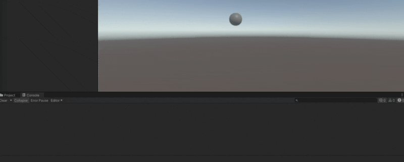

# arduino-unity-serial-bridge

A physical button on an Arduino Mega 2560 controls an object in Unity. Pressing the button sends a message over USB serial, and Unity toggles a sphere's color between red and white.

This is a small proof of concept for getting real-world hardware input into a Unity scene, a starting point for XR and physical-computing prototypes.



## Hardware photos
 
<p align="center">
  
</p>
<p align="center">
  
</p>


## How it works

1. The Arduino reads a push button on **pin 2** using `INPUT_PULLUP` (the other side of the button goes to GND, so the pin reads LOW when pressed).
2. Each press toggles the Mega's built-in LED on **pin 13** (and an optional external LED) and prints `ON` or `OFF` over serial at **9600 baud**.
3. A Unity script (`ArduinoSerialReader.cs`) opens the serial port, reads each line, and sets the sphere's color: **red** on `ON`, **white** on `OFF`.

## Hardware

- Arduino Mega 2560 (Elegoo clone) with USB cable
- Push button
- Breadboard and jumper wires
- LED and resistor (optional, mirrors the pin 13 LED)

**Wiring:** button leg to digital pin 2, the diagonally opposite leg to GND. No external resistor is needed for the button.

## Software

- Unity 2022.3.62f2 (URP)
- Arduino IDE (to upload the sketch)
- Unity uses `System.IO.Ports`, so set **Edit > Project Settings > Player > Api Compatibility Level** to **.NET Framework**.

## Setup

1. Open `arduino/Basic/Basic.ino` in the Arduino IDE, select **Arduino Mega or Mega 2560** and your port, then upload.
2. Find your board's serial port:
   - macOS: run `ls /dev/cu.*` in Terminal (look for `/dev/cu.usbmodem...`)
   - Or check **Tools > Port** in the Arduino IDE
3. Open this folder as a project in Unity Hub (Unity 2022.3.62f2).
4. Select the object with the `ArduinoSerialReader` component and set its **Port Name** to the port from step 2. Baud rate must be **9600**.
5. Close the Arduino IDE Serial Monitor (it blocks the port), press **Play**, and press the button.

## Troubleshooting

- **`IOException: No such file or directory`**: the port name is wrong or the board is unplugged. Port names change between USB ports and machines.
- **Port busy or won't open**: close the Arduino IDE Serial Monitor.
- **Nothing happens on button press**: check that the button's two wires are on opposite sides of the breadboard's center gap, one to pin 2 and one to GND. Pressing it should toggle the Mega's built-in "L" LED.

## Project structure

```
Assets/            Unity scene and scripts
arduino/Basic/     Arduino sketch (Basic.ino)

```

## Next steps

- Two-way communication (Unity to Arduino)
- More inputs (multiple buttons, potentiometer, sensors)
- Drive an XR interaction with the hardware input
